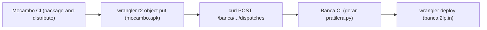

# Especificação Técnica — Ticket #12: Atualização Automática da Pratilera via Dispatch

## 1. Contexto & Objetivos
O aplicativo Flutter do Mocambo é empacotado hermeticamente e distribuído no Cloudflare R2 (`twolp-bucket/mocambo.apk` / `https://bucket.2lp.in/mocambo.apk`).
Para assegurar que o catálogo da loja soberana Pratilera (`banca`) permaneça continuamente atualizado a cada novo build na branch `main`:
1. O pipeline de distribuição em `.forgejo/workflows/distribution.yml` e o script `scripts/package-apk.sh` devem disparar a re-geração do índice da Banca através da API de workflows do Codeberg.
2. A comunicação deve ser autenticada via token de automação `CODEBERG_TOKEN`.

## 2. Arquitetura

## 3. Critérios de Aceite
- [x] `scripts/package-apk.sh` executa POST para a API de workflow dispatch da banca se `CODEBERG_TOKEN` estiver presente.
- [x] `.forgejo/workflows/distribution.yml` propaga `CODEBERG_TOKEN: ${{ secrets.CODEBERG_TOKEN }}` para a execução do script.
- [x] Teste de contrato em `tests/distribution_contract_test.rs` valida a presença do endpoint e variável no script e no workflow.
