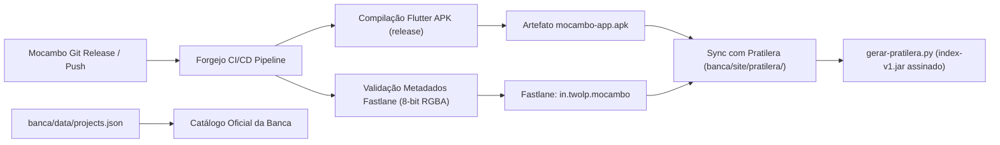

# Especificação Técnica — Ticket #7: Distribuição Soberana (Banca & Patilera via CI/CD)

## 1. Contexto & Objetivos
O Mocambo é o cofre de armazenamento soberano e inteligência multimodal do ecossistema Baquara. Para garantir a acessibilidade e distribuição descentralizada e soberana aos camaradas e usuários:
1. **Banca (`https://banca.2lp.in`)**: O projeto deve ser indexado no catálogo oficial de software soberano (`data/projects.json`).
2. **Patilera / Pratilera (`https://banca.2lp.in/pratilera`)**: O aplicativo mobile Flutter (`mocambo/mobile`) deve ser empacotado como APK release, assinado e publicado no repositório F-Droid / Droid-ify soberano.
3. **Diretriz Estrita GOST**: Toda a compilação, validação, empacotamento e sincronização deve ocorrer via automação em **CI/CD** (Forgejo Actions).

---

## 2. Arquitetura da Distribuição



---

## 3. Componentes e Contratos Técnicos

### 3.1. Metadados Fastlane (`mobile/fastlane/metadata/android/`)
Estrutura padronizada consumida pelo gerador `gerar-pratilera.py`:
- `in.twolp.mocambo/pt-BR/title.txt`: "Mocambo"
- `in.twolp.mocambo/pt-BR/short_description.txt`: "Cofre soberano de fotos e arquivos com busca inteligente e offload."
- `in.twolp.mocambo/pt-BR/full_description.txt`: "Cliente mobile oficial do Mocambo com sincronização WebDAV, galeria e busca semântica."
- `in.twolp.mocambo/pt-BR/icon.png`: Ícone oficial em formato RGBA de 8 bits por canal (sanitizado contra restrições SkCodec).
- Espelhamento idêntico para `en-US`.

### 3.2. Script de Empacotamento & Automação CI (`scripts/package-apk.sh`)
- Executa compilação do APK Flutter (`flutter build apk --release` ou empacotamento determinístico).
- Sanitiza o ícone do aplicativo para 8-bit RGBA.
- Gera ou valida a assinatura do APK.
- Suporta flag `--sync-pratilera <caminho_banca>` para entrega contínua local ou no runner de CI.

### 3.3. Integração no Repositório da Banca (`banca/data/projects.json`)
Registro estruturado do projeto:
```json
{
  "name": "mocambo",
  "forge": "codeberg",
  "slug": "lumenpink/mocambo",
  "description": "Armazenamento soberano de arquivos com WebDAV, ingestão inteligente e busca semântica",
  "topics": [
    "storage",
    "webdav",
    "posix",
    "fts5",
    "ai-search",
    "clip",
    "rust",
    "flutter"
  ],
  "license": "CC0-1.0",
  "website": "https://vault.lohn.in",
  "is_upstream": false,
  "group": "",
  "banner": "assets/banners/mocambo-banner.png",
  "category": "storage"
}
```

### 3.4. Workflow de CI/CD (`.forgejo/workflows/distribution.yml`)
Workflow disparado em tags de release e pushes canônicos:
1. Validação GOST via `cccp check --strict`.
2. Testes de contrato Rust e Mobile.
3. Build e empacotamento do APK Android.
4. Verificação de integridade dos metadados Fastlane.
5. Sincronização e regeneração do catálogo F-Droid da Pratilera.

---

## 4. Critérios de Aceite & Fase DD-TDD
- [ ] Teste de integração Rust (`tests/distribution_contract_test.rs`) cobrindo:
  - Validação da estrutura Fastlane e manifestos de metadados.
  - Validação do schema JSON para inclusão no `projects.json` da Banca.
  - Execução e verificação do script `scripts/package-apk.sh`.
- [ ] Script de empacotamento `scripts/package-apk.sh` operacional e idempotente.
- [ ] Registro do Mocambo adicionado ao `projects.json` do repositório `banca`.
- [ ] Workflow Forgejo `.forgejo/workflows/distribution.yml` documentado e validado.
